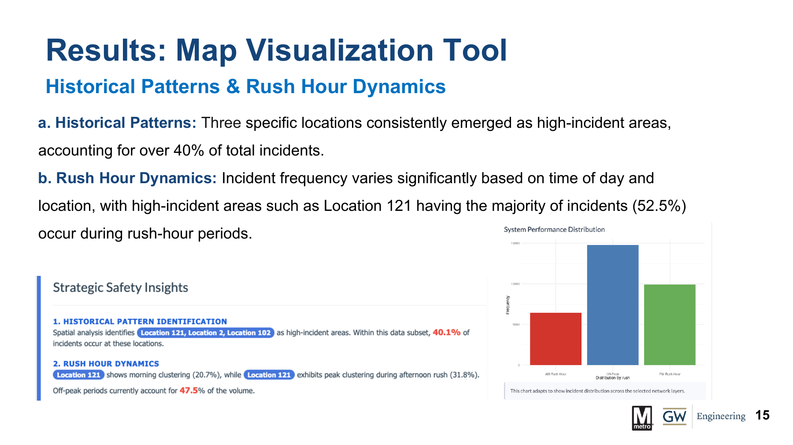
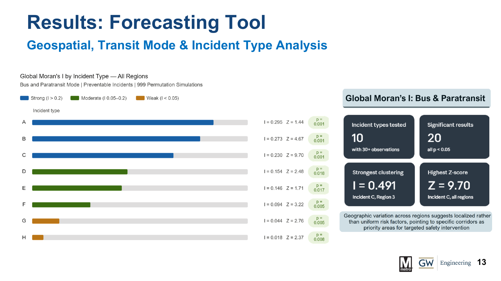
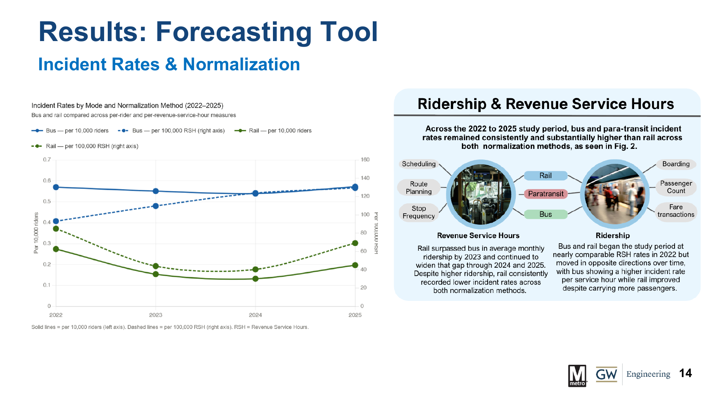

# WMATA Safety Analytics: Data Architecture and Forecasting Tool

Systems Engineering capstone project with the Washington Metropolitan Area Transit Authority (WMATA) Safety Informatics and Solutions team. We redesigned WMATA's safety data architecture and built forecasting and mapping tools so analysts can see where and when incidents happen. The work was published by IEEE and won **Best Paper** at the Andrew P. Sage Memorial Design Competition and an **Honorable Mention** at the Systems and Information Engineering Design Symposium (SIEDS) 2026.



## Problem

WMATA's safety data arrives from many vendors, systems and PDF reports in inconsistent formats. Analysts spend a lot of time cleaning data, the risk of errors goes up, and the agency mostly reacts to incidents after they happen instead of anticipating them.

## What we built

- **Redesigned data architecture:** cleaned and validated every dataset, logged naming and formatting inconsistencies, and designed a standardized, centralized model, documented as an entity-relationship diagram in Lucidchart.
- **Forecasting tool:** a Prophet time-series model on weekly incident counts (12-week forecasts with 95% confidence intervals), run separately for bus/paratransit and rail.
- **Geospatial hotspot analysis:** Global Moran's I with 999 permutation tests to check whether incidents cluster geographically by region, transit mode and incident type.
- **Normalized incident rates:** incidents per 10,000 riders and per 100,000 revenue service hours, so bus and rail can be compared fairly.
- **Interactive map tool (this repository):** an R Shiny app that plots incidents on a map and filters by year, season, rush-hour period, incident type, location and transit mode, with an auto-generated "Strategic Findings" report and charts.

## Key findings

- Ten of fifteen regions showed statistically significant clustering of bus incidents (p < 0.05), so incidents concentrate in specific corridors rather than being spread randomly.
- Rail incident rates per 100,000 revenue service hours fell from 84.9 in 2022 to a low of 40.4, while bus rates rose over the same period.
- In the map tool, three locations accounted for over 40% of incidents, and at one high-incident location 52.5% of incidents happened during rush hour.




## Data and privacy

WMATA's incident data is confidential, so **it is not included here**, and neither are screenshots of the map with real incident locations. All region and incident names in the app are anonymized (for example, "Location 12" and "Incident Type 3"), and the images above use the anonymized labels.

To let anyone try the app, `data/sample_incidents.xlsx` contains **600 made-up incidents** around the DC area with the same columns as the real data. Nothing in it is real.

## Run the map tool

1. Install [R](https://cran.r-project.org/) and [RStudio](https://posit.co/download/rstudio-desktop/).
2. Open `app.R` and click **Run App**. Missing packages install automatically the first time.
3. The app loads the sample data. To use your own file, change `DATA_PATH` at the top of `app.R`.

Required columns: `Incident_Type`, `Latitude`, `Longitude`, `Incident_Date`, `INCIDENT_TIME` (HH:MM:SS) and `Transit Mode`.

**Tools:** R (`shiny`, `leaflet`, `sf`, `tigris`, `dplyr`, `ggplot2`), Python (Prophet, spatial statistics), Lucidchart.

## Repository structure

```
├── app.R                        # R Shiny map and dashboard app
├── data/
│   └── sample_incidents.xlsx    # Synthetic sample data (not real WMATA data)
└── figures/                     # Slides showing the tool and results
```

## Team

Alana Lee, Amna Maqsood, Gladys Fong and Shannon Zhang, with advisors from WMATA and The George Washington University, Department of Engineering Management and Systems Engineering.

**Paper:** "Transit Safety Modeling and Operational Efficiency: An Integrated Data Architecture and Forecasting Approach for Washington Metropolitan Area Transit Authority," IEEE, 2026.
